
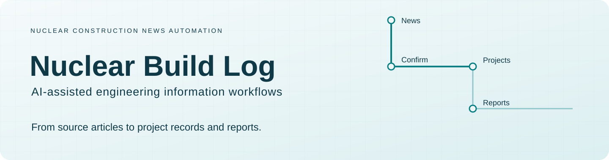

**[English](README.en.md) · [简体中文](README.md)**

# Nuclear Build Log | Nuclear Construction News Automation & AI Workflow Platform

**Automatically collect nuclear construction news in China and connect AI-assisted event recognition with unit milestones, project records, progress charts and engineering reports.**

Nuclear Build Log (核程志) is a **nuclear engineering news collection and information workflow platform**. It brings together construction updates from nuclear companies, engineering organizations and industry publications, reads article bodies, separates publication dates from engineering event dates, and links validated events to specific units and milestones after user confirmation.

**AI-driven automatic maintenance of nuclear construction progress:** With a configured API, AI identifies the specific unit, actual engineering event, associated date and milestone from news article bodies. After the user confirms an article, software validates the result and automatically maintains unit progress and project records, with linked updates to progress visualization and the nuclear project map. Rule-based processing remains available without an API or when model results cannot be used.

It is designed for nuclear power plant owners, engineering, procurement and construction (EPC) teams, design institutes, construction and installation contractors, commissioning teams and engineering information managers. The workflow connects news monitoring, event verification, project tracking, regulatory document retention and English nuclear engineering newsletter production, reducing repeated website searches and manual ledger maintenance.

[Workflow explained](#reading-the-workflow) · [Detailed workflow](docs/ai-workflow.en.md) · [Real screens](#actual-application-screens) · [AI model setup](#bring-your-own-ai-models-multiple-api-profiles-and-model-switching) · [Real outputs](#real-output-examples) · [Updates](CHANGELOG.en.md) · [Contact](#contact)

This is a public product showcase, not an open-source release of the platform. Core code, full business databases, API keys, model weights and installers remain private. No public live service URL is currently listed. Screenshots and real outputs below were captured on **29 October 2026** and represent the maintained records at that time.

## Workflows for nuclear engineering professionals

| Engineering information task | How the platform helps |
| --- | --- |
| Nuclear construction news monitoring | Check sources on a schedule, collect on demand and import web or WeChat article links into one ledger with sources, dates, summaries and original evidence |
| Project progress and unit milestone tracking | Identify the unit, engineering event and event date; assess updates after confirmation without treating planned or historical events as completed milestones |
| Multi-project and multi-site information management | Browse news by publication month, confirmation status or unit, with shared records across project status, progress charts and the nuclear project map |
| Nuclear regulatory document archiving | Retain available official environmental impact assessment reports, construction licences and operating licences for primary plants/units, with attachments, web snapshots and versions |
| Engineering newsletters and English technical reporting | Select articles in batches, generate editable English engineering content grounded in source evidence, and export an individual article or a complete issue |

News collection is the entry point; AI semantic interpretation assists decisions; the project ledger connects the workflow; charts, the map, document archives and reports serve different information needs.

Engineering information can cover project approval and construction start, first concrete (FCD), nuclear island dome lifting, equipment deliveries and installation, cold/hot functional testing, first fuel loading, first criticality, grid connection and commercial operation (COD). The platform distinguishes an engineering event worth collecting from an event sufficient to advance a unit's stage.

### Automatic collection and archiving schedule

- **Nuclear engineering news: automatically collected and archived every six hours by default, equivalent to four scheduled rounds per day.** Collection covers the configured domestic nuclear news sources and supplementary search channels. The workflow reads article bodies, handles duplicates and retains news in a ledger for publication-month browsing and ongoing tracking.
- **Regulatory documents: automatically checked and archived every three days by default.** The workflow checks relevant official sources and retains in-scope document records, available attachments and web snapshots.

On-demand collection and checks are also available. Scheduled tasks require the service to be running; a local installation cannot keep collecting while its computer is off or the service is stopped.

## How AI and software work together

The platform combines AI semantic interpretation with deterministic software checks and user confirmation. AI helps interpret events and classify relevant information; software verifies evidence, controls database changes and keeps a rule-based fallback available.

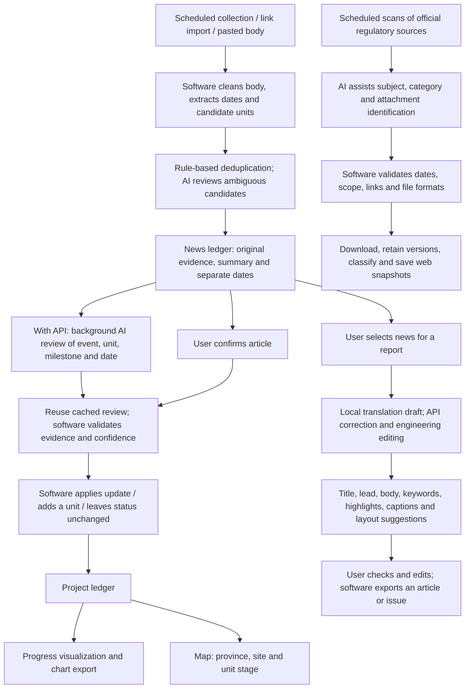

### Reading the workflow

The diagram describes the platform's engineering information workflow across three paths: **news-to-project updates, regulatory archiving and report production**. The paths share sources and facts while retaining separate controls. Collecting a report of a future milestone does not automatically advance a unit's status, and producing a newsletter does not change the project ledger.

1. **Read the source before interpreting the event.** Scheduled collection and manual imports feed the same news-processing chain. Software cleans article bodies, records publication and engineering event dates separately, and identifies candidate units and rule-based results. Missing body text or unsupported dates are not presented as verified facts.
2. **Use rules first for duplicates, with AI for ambiguous cases.** Software removes clear duplicates; a configured API can review a limited set of borderline candidates. Multiple reports of one unit's first fuel loading may describe one event, whereas deliveries of different equipment must not be merged merely because both are deliveries.
3. **Review in the background and validate at confirmation.** AI distinguishes completed work from planned activities and associates the actual unit, milestone and body-text date. Software caches the decision and checks its evidence. Confirmation reuses a valid cached review where possible; a high-confidence result is accepted only after validation, otherwise rules provide the fallback. Background review alone does not update project records.
4. **Drive three views from one ledger.** Software updates an existing unit, adds a unit when supported, or leaves status unchanged. Project status, progress visualization and the map read the same records. The chart computes elapsed time and the map displays locations and stages, rather than each independently reinterpreting the news. Withdrawing confirmation can reverse the corresponding automatic effects; manual maintenance also feeds these views.
5. **Archive regulatory material through a separate official-source path.** Software scans notices, AI helps identify primary plant/unit subjects, document types and relevant attachments, and software validates and downloads the files with version retention. Archiving a document does not update a unit's status and does not imply legal or policy interpretation.
6. **Let users select, AI edit and software format reports.** With an API, the model uses source text and engineering facts to correct translation and produce a title, lead, body, highlighting, captions and layout suggestions. Users can edit the result. Software enforces the document style and exports an article or whole issue in engineering-date order. Real outputs appear below.

AI nodes require an available configured API. **Rule-based paths remain available without an API.** Arrows show information flow, not a guarantee that every article causes a project-stage change.

| Stage | AI contribution when an API is configured | Software checks and execution |
| --- | --- | --- |
| News understanding | Identify the main reported event, affected units, event state and the relationship between an event and a body-text date | Collect and clean articles; extract and validate dates; find candidates; verify original evidence. News-card summaries retain their rule-based generation logic |
| Duplicate reports | Review a limited set of ambiguous candidate duplicates | Deduplicate links and content; distinguish unique milestones from repeatable equipment events |
| Project updates | Review whether a milestone actually occurred and extract source-supported new-project information | Apply changes after user confirmation; accept validated high-confidence AI decisions and fall back to rules otherwise; reverse corresponding automatic effects when confirmation is withdrawn |
| Charts and map | Improve the upstream interpretation of the news | Read the same project ledger, calculate durations and display unit stages and plant locations; manual edits also feed these views |
| Regulatory archives | Classify the primary plant/unit subject and document type; help select relevant attachments from mixed notices | Scan official sources, enforce date/scope limits, validate downloads, retain hashes and versions, and archive files by category |
| Engineering reports | Correct translation and produce engineering-focused titles, leads, text, keywords, highlighting, captions and layout suggestions | Supply facts and sources, preserve edits, enforce the document template and export individual articles or a whole issue in event-date order, with undated items last |

Background pre-review and cached decisions reduce repeated work at confirmation. AI does not write project data directly. A report saying a unit *will soon* enter operation must not be treated as completed commercial operation; a Unit 3 event must not automatically update Unit 4.

Without an API, rule-based collection, event interpretation, project updates and regulatory archiving remain available. An installed local translation model supplies local drafts, with basic program-generated report content as a fallback. This is a functional fallback, not a claim of equal output quality.

The [English workflow guide](docs/ai-workflow.en.md) explains the separate news, project, regulatory and report paths, including confirmation and evidence checks.

## Actual application screens

These captures use the running website and real maintained records, rather than fictional demo data.
The screenshots retain the Chinese UI as captured; the platform also offers English and French interface options.

### News collection

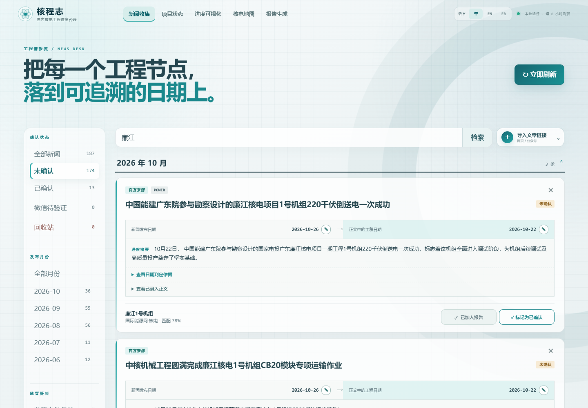

The ledger supports monthly browsing, confirmation, imports, editable dates and report selection. [Original Lianjiang article](https://power.in-en.com/html/power-2480128.shtml).

### Project status

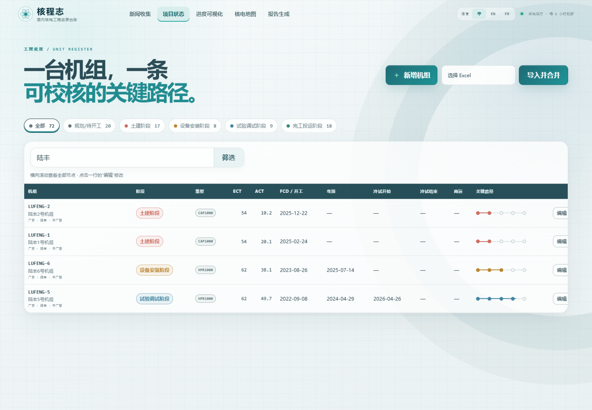

Confirmed news may update milestones or add units. Progress charts and the map read the same ledger. New sites require sufficient location information and the applicable verification before mapping.

### Nuclear project map: province and site selection

**After clicking Guangdong Province:** the map highlights the province and displays its nuclear project site markers. The panel on the right lists project names, companies, unit codes, reactor types and current engineering stages.

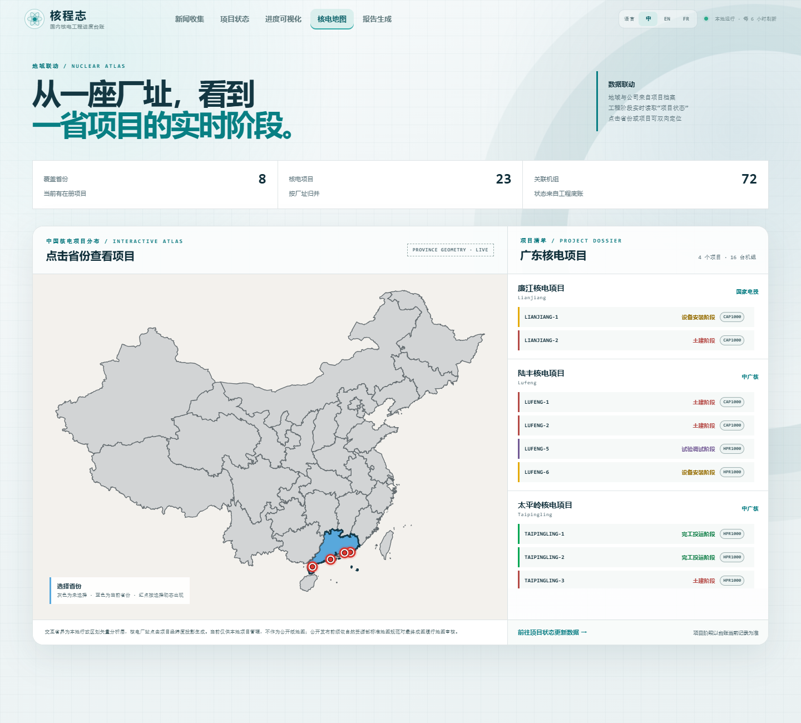

**After selecting the Lufeng project:** the map shows a single labelled Lufeng site marker and highlights the matching project card on the right. Clicking a map marker also selects its project, linking the geographic view and project list in both directions.

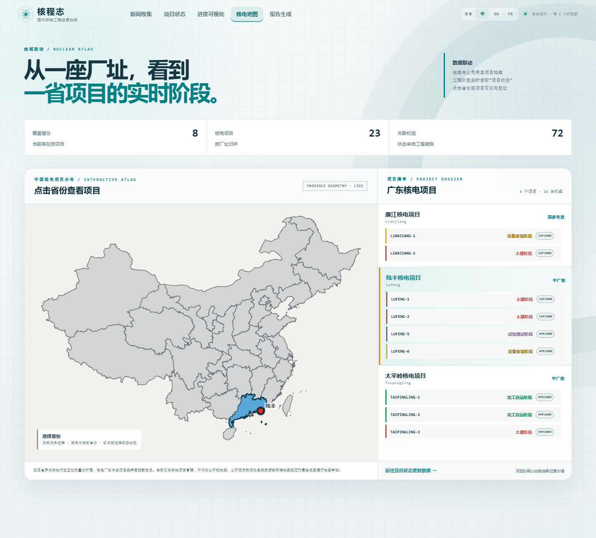

Click a unit code to open its project-status record. Stage text follows the progress-chart colour scheme. The map reads the same project ledger, so effective updates from confirmed news and manual maintenance also feed the displayed stages. [Step-by-step map guide](docs/map-guide.en.md).

### Progress visualization: unit stages and construction durations

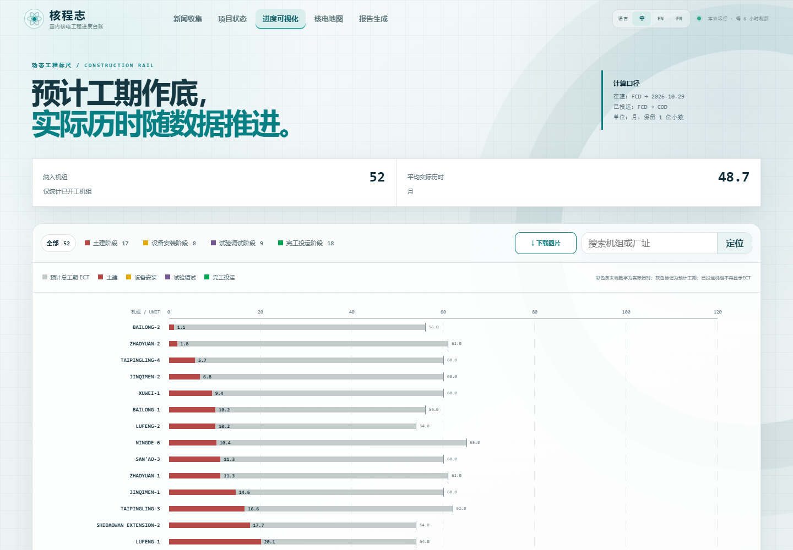

The workspace supports stage filtering, unit searches and comparison of ACT elapsed duration with ECT planned duration. Planned units are excluded and commercially operating units do not display ECT. The complete exported chart appears under Real output examples below.

### Regulatory archives

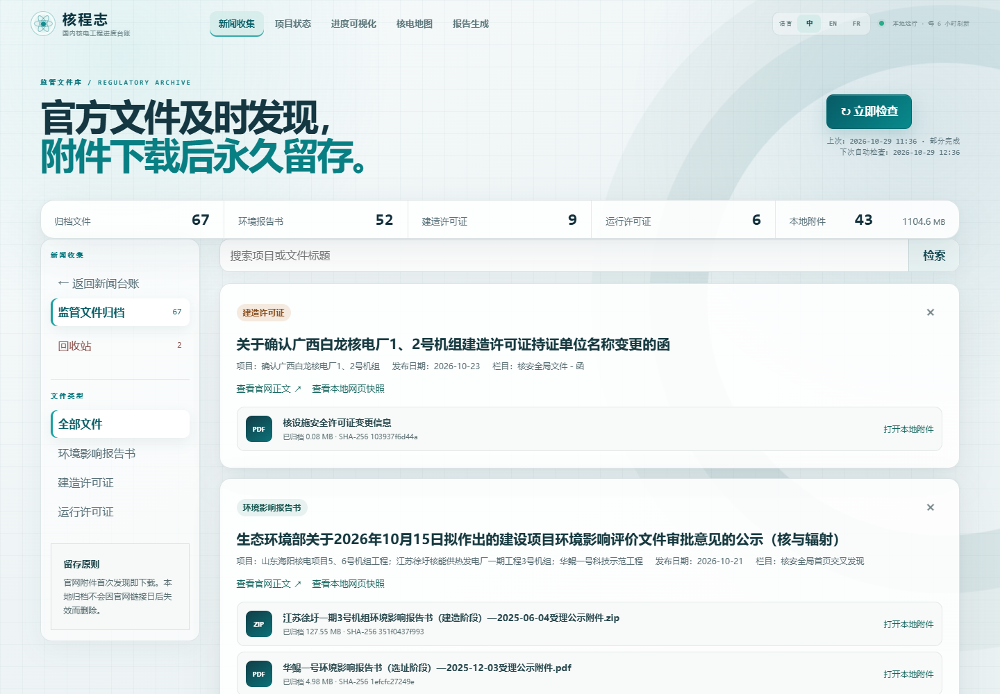

Coverage includes primary plant/unit environmental impact assessment reports and construction/operating licences from 1 January 2025 onward. Routine checks run every three days, with retries for failures. Classification and archiving do not imply automated legal or policy interpretation.

### Report workspace

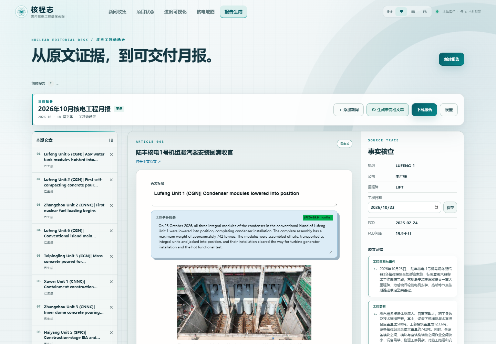

The user selects news and checks facts, text and captions before exporting. Report preparation is separate from news confirmation and project-state changes. [Original condenser article](https://power.in-en.com/html/power-2480157.shtml).

### Bring your own AI models: multiple API profiles and model switching

Users can add **multiple OpenAI-compatible API/model profiles**, each with its own display name, endpoint, model name and API key. Create separate profiles for providers, models or workflows, then choose the active model through the interface without changing application code.

**Manage and add models:** open Report builder → Settings → Manage models to add, edit or delete a profile. This actual management-window capture shows the existing profile and add-model form. The API key field is empty; no key is shown.

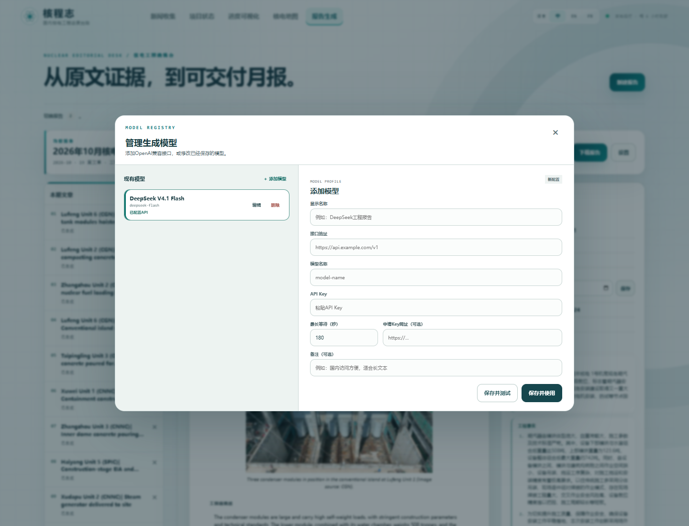

**Select and switch models:** saved API profiles appear under Settings → Generation model, with the current selection marked. Profiles are retained independently and can be selected for subsequent model calls. Switching alone does not rewrite saved report content.

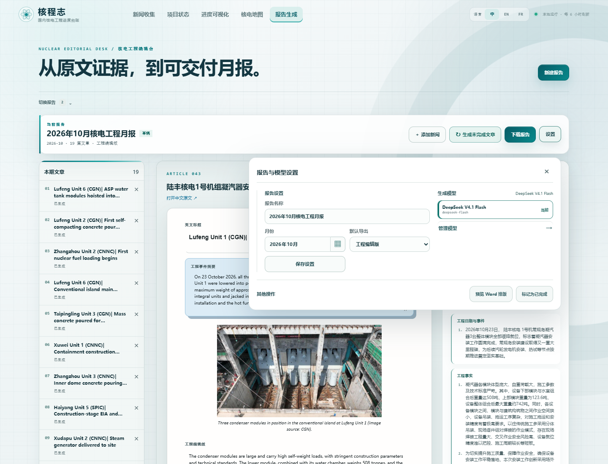

The screenshots retain the actual configured state. Report generation and enabled AI assistance for news semantic review and regulatory archiving reuse the selected API profile. [Guide to adding API profiles and switching models](docs/model-guide.en.md).

## Real output examples

### Exported progress chart

[Full-resolution PNG](assets/progress-chart.png)

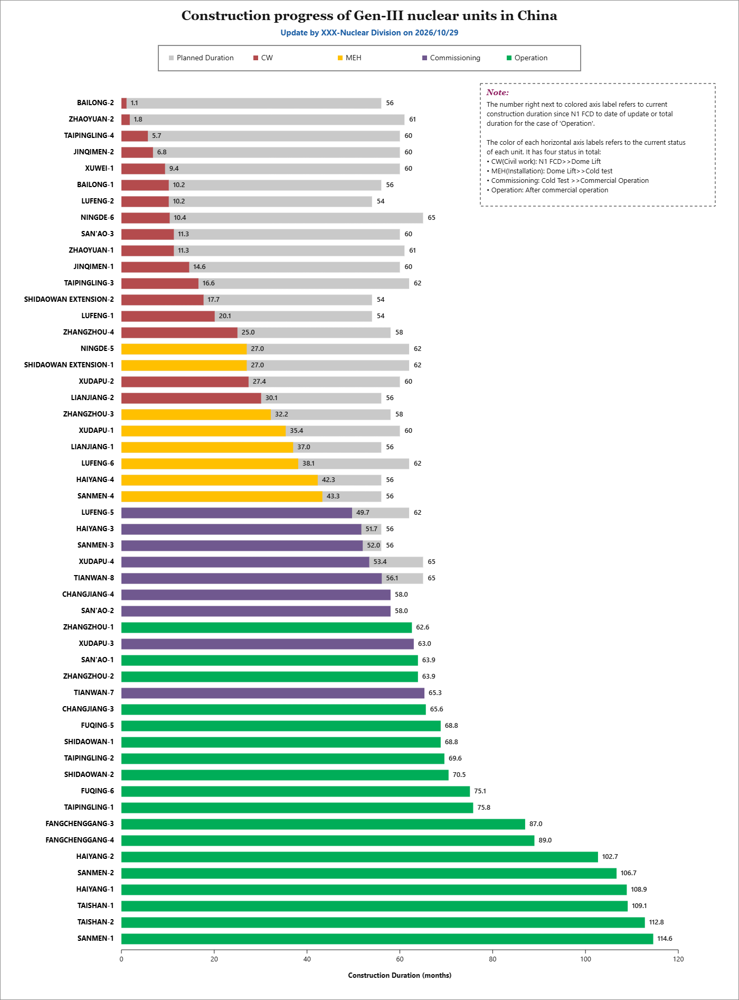

Generated by the website's existing chart-export function using the ledger snapshot, retaining its legend and Note box. The public copy's attribution has been replaced with **XXX-Nuclear Division**. Planned units are excluded; operating units have no ECT bar. ACT uses total elapsed days divided by 30.4375, ending at today's date for units under construction and at COD for operating units.

### Generated engineering editorial article

[Actual report PDF](examples/lufeng-1-editorial-example.pdf) · [Corresponding DOCX](examples/lufeng-1-editorial-example.docx)

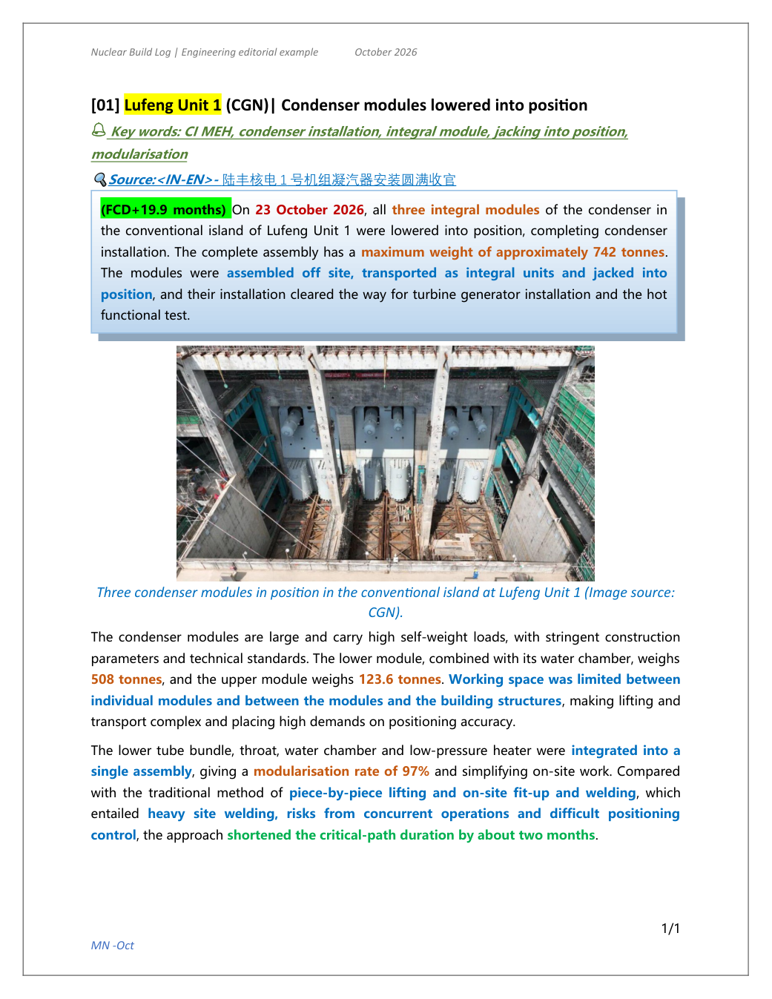

This is an existing generated article exported through the application's individual-article workflow. It shows the unit title highlight, source hyperlink, months since FCD, blue lead box, photograph, caption and highlighted body text. The lead and body have not been manually rewritten for this showcase. Only the public copy's internal header attribution and author metadata were adapted; the production template and saved business content were not changed. News and source photographs remain the property of their respective publishers.

The earlier [fictional PDF example](examples/engineering-report-demo.pdf) and [DOCX](examples/engineering-report-demo.docx) remain available as clearly separate formatting samples.

[Step-by-step visual walkthrough in English](docs/walkthrough.en.md)

## Feedback and publication scope

Use [Issues](../../issues) for suggestions, reproducible problems or enquiries. Remove credentials, personal information and confidential content from submissions. Pricing, service commitments and a public launch date have not been announced here.

### Contact

- **Email:** [18085285748@163.com](mailto:18085285748@163.com)
- **WeChat:** XHB18085285748

For product enquiries, feedback, deployment or collaboration, please get in touch. Report security concerns privately by email.

The showcase contains selected public-facing materials, not the platform's private implementation, prompts, full data or credentials. See [NOTICE.en.md](NOTICE.en.md). Automated extraction and AI decisions still require source checking; inaccessible or previously removed attachments cannot always be recovered.
