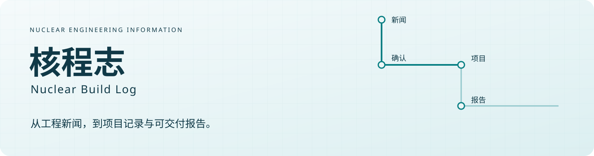
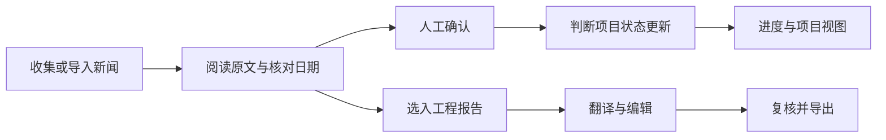

# 核程志 · Nuclear Build Log

**把新闻里的工程事件，整理成可追溯的项目记录与工程报告。**

核程志面向国内核电工程信息的持续跟踪：汇集新闻、区分发布日期与工程日期，维护机组状态，归档监管附件，并辅助制作英文工程月报。

[功能介绍](#能做什么) · [界面演示](#界面演示) · [报告样例](#报告样例) · [更新记录](CHANGELOG.md) · [提交建议](../../issues/new/choose) · [English](README.en.md)

> 这是产品展示与反馈仓库。平台核心源码、真实数据库、API 密钥、本地模型和安装包不在本仓库公开。当前不提供公开在线试用地址。截图与样例均使用明确标注的虚构演示数据，不代表任何真实核电项目进展。

## 能做什么

| 工作场景 | 平台提供的能力 |
| --- | --- |
| 持续收集工程新闻 | 定时采集与手动链接导入、正文读取、重复报道处理、月份检索、已确认/未确认管理 |
| 核对工程事件 | 分别呈现新闻发布日期与正文工程日期，保留原文证据，并允许人工更正 |
| 维护项目状态 | 新闻确认后判断机组及工程节点；支持手动维护、撤销确认后的联动恢复与更新提醒 |
| 查看工程进度 | 项目状态与进度图联动，提供图表图片导出；支持按省份查看厂址和项目概况 |
| 留存监管资料 | 跟踪核电厂、机组主体环评报告书与建造/运行许可证，保存可下载附件与本地网页快照 |
| 制作工程报告 | 从选定新闻形成翻译和工程编辑内容，编辑事实、标题、图注和配图，导出整期或单篇报告 |
| 使用多语言界面 | 提供中文、英文、法语界面与本地翻译；报告制作可配置大模型服务 |

### 一条信息如何进入工作流

用户决定是否确认新闻和采用报告内容。自动提取、翻译及大模型辅助结果仍需要结合原文核验；官网已删除且从未留存的附件不保证能够恢复。

## 界面演示

以下图片来自独立本地演示环境中的实际产品界面；机组名称、新闻和报告内容均为演示数据。

### 新闻收集与事件核对

### 项目状态维护

### 工程报告工作台

[查看完整图文导览](docs/walkthrough.md)

## 报告样例

[查看演示报告 PDF](examples/engineering-report-demo.pdf) · [下载演示报告 Word](examples/engineering-report-demo.docx)

样例使用平台实际导出流程制作，全部事实为虚构演示内容，不能用于工程判断。公开样例的页眉署名已替换为核程志演示标识。它用于展示报告结构与呈现方式，不构成真实项目报道或对翻译准确性的承诺。

## 使用与交流

如果你也在整理核电工程信息，欢迎通过 [Issues](../../issues) 提交使用场景、功能建议或界面问题。请提供具体步骤及预期结果；截图应隐藏密钥、个人信息和不宜公开的工作资料。

本仓库用于产品展示，不提供平台源码安装。需要讨论使用方式、部署或合作，可提交一条不含敏感信息的[交流请求](../../issues/new/choose)，由维护者后续沟通。收费方案、服务范围和正式上线时间尚未在此公布。

## 公开范围

- 公开：产品说明、演示截图与图文导览、虚构内容报告样例、更新记录和反馈模板。
- 不公开：核心程序、采集规则与提示词、真实业务数据、运行环境、模型文件、凭据和服务器配置。

本仓库不是平台的开源发行版。展示材料及第三方标识的使用说明见 [NOTICE.md](NOTICE.md)。
