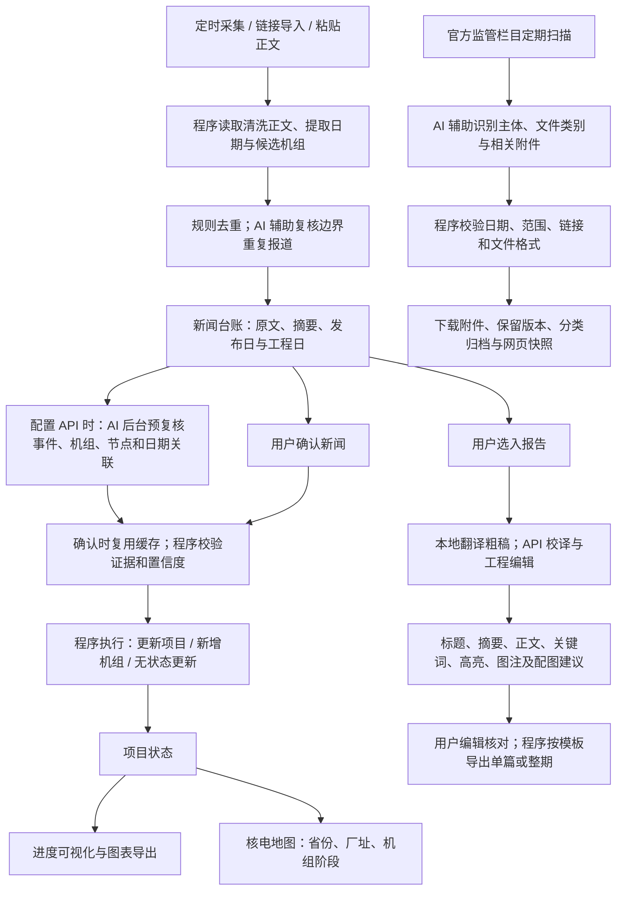

**[简体中文](README.md) · [English](README.en.md)**

# 核程志｜核电工程新闻自动采集与 AI 工作流平台

**自动收集国内核电建设新闻，以 AI 辅助工程事件识别，将新闻台账、机组里程碑、进度图、核电地图和工程报告连接为可追溯的工作流。**

核程志（Nuclear Build Log）是面向国内核电工程的**新闻自动收集与信息处理工作流平台**。它持续汇集分散在核电企业、工程单位和行业媒体的工程进展报道，读取新闻正文，区分发布日期与实际工程日期，并在用户确认后，将有效工程事件关联到具体机组和里程碑，驱动项目状态、进度可视化和核电地图更新。

平台面向核电业主、工程总承包（EPC）、设计院、施工安装、调试及工程信息管理人员，帮助持续跟踪核电项目建设进度、整理工程情报、留存监管文件和制作英文工程月报。核心工作是把“逐个网站查新闻、核对日期、识别机组、手动维护台账”连接为一套可核对、可编辑的信息工作流。

[AI 如何参与](#ai-如何参与完整工作流) · [流程图详解](#流程图详解) · [真实界面](#真实界面) · [进度图与报告成品](#真实输出成品) · [完整流程说明](docs/ai-workflow.md) · [更新记录](CHANGELOG.md) · [联系我](#联系方式)

> 本仓库用于产品展示与反馈；核心源码、完整业务数据库、API 密钥、本地模型和安装包保持私有。目前未提供公开在线试用地址。以下界面和真实成品截取于 **2026年10月29日**，反映当时的台账记录，不能替代最新官方信息。

## 面向核电工程人员的工作场景

| 工作场景 | 平台怎样协助 |
| --- | --- |
| 核电建设新闻与工程情报跟踪 | 定时检查新闻来源，支持立即采集及普通网页、微信公众号链接导入，集中查看原文、摘要、日期和来源 |
| 核电工程进度与机组里程碑维护 | 识别正文报道的是哪台机组、什么工程事件及何时发生；确认后判断是否应更新台账，避免把计划或背景内容当成已完成节点 |
| 多项目、多厂址工程信息整理 | 按发布月份、确认状态和机组检索新闻，在项目状态、工程进度图与核电地图之间共享同一份项目记录 |
| 环境影响报告书和核安全许可证留存 | 跟踪核电厂/机组主体的环评报告书、建造许可证及运行许可证，保存可取得的官方附件、网页快照与版本 |
| 核电工程月报与英文技术报道制作 | 批量选择新闻，利用原文证据与工程事实生成可编辑的英文工程内容，输出单篇报道或整期报告 |

这是一套面向工程信息管理的工作流：新闻采集是入口，AI 语义识别是辅助判断层，项目台账是联动中心，图表、地图、资料归档与报告是不同使用出口。

工程信息可涉及项目核准与开工、首次混凝土浇筑（FCD）、核岛穹顶吊装、设备到货与安装、冷态/热态功能试验、首次装料、首次临界、并网和商业运行（COD）。系统分别判断“这是一条值得收录的工程新闻”与“这条新闻是否足以改变机组阶段”，不把所有工程进展都当成阶段跃迁。

服务运行时，新闻默认每6小时检查一次，监管资料默认每三天检查一次，也支持手动立即采集或检查；本地电脑关机或服务停止时，定时任务不会继续执行。

## AI 如何参与完整工作流

平台的特色是 **AI 语义理解与程序协作**。配置大模型 API 后，AI 辅助辨别新闻实际报道的事件、涉及哪些机组、是否达到工程节点，以及监管文件的主体和类别；程序核验原文证据、控制数据变更，并在没有 API 或模型结果不可用时提供规则兜底。用户确认新闻后，系统才执行相应的项目状态联动。

### 流程图详解

这张图描述的是平台处理核电工程信息的业务流程，分为**新闻与项目联动、监管资料归档、工程报告制作**三条路径。三者共享来源与事实，但有各自的任务和确认边界：采集新闻不会直接把机组改为商运，制作报告也不会修改项目状态。

1. **先获取原文，再识别工程事件。** 定时采集和手动导入进入同一新闻处理链路。程序清洗正文、分开记录发布日期与工程日期，并建立候选机组和规则判断。原文未读到或日期没有依据时，不伪装成已完成读取或已知日期。
2. **先规则去重，AI 补充语义判断。** 程序先排除明确重复报道，AI 在有 API 时复核少量边界候选。例如，同一机组首次装料的转载报道可能是一件事；同一机组的不同设备到货则不能仅因动作相同就合并。
3. **后台预复核，确认时采用有效结果。** AI 辨别“已经完成”与“即将开展”，确认具体机组、节点及其对应的正文日期。程序缓存结果并验证原文证据；用户确认时，优先复用可用缓存，高置信且校验通过才采用，否则走规则兜底。后台复核本身不等于已经修改台账。
4. **同一份台账驱动三个视图。** 程序执行更新已有机组、新增符合条件的机组，或保持状态不变；项目状态、进度可视化和核电地图读取相同记录。进度图显示工期，地图显示位置及阶段，不再各自从新闻猜一遍状态。撤销确认可回退对应自动影响，人工维护也能联动视图。
5. **监管文件走独立的官方资料路径。** 程序扫描官方公示，AI 辅助识别核电厂/机组主体、文件类别及相关附件；程序核验范围、日期和文件，再下载、校验并留存版本。文件归档不触发机组状态变更，也不等于已经生成法律或政策解读。
6. **报告由用户选稿，AI 编辑，程序排版。** 选定新闻后，模型利用原文和工程事实校译并生成工程编辑内容，包括摘要、正文、高亮、图注和布局建议。用户可修改，程序按固定样式导出单篇或整期，并按工程日期排序。真实成品见下方进度图与工程编辑版示例。

图中的 AI 节点均以配置可用 API 为前提；**没有 API 仍保留规则处理路径**。箭头表示信息如何流转，并不表示任何一篇新闻都会产生阶段变化。

| 环节 | AI 提供的判断与生成 | 程序负责的校验与执行 |
| --- | --- | --- |
| 新闻理解与机组匹配 | 识别主事件及实际涉及的机组，区分已发生、计划、准备和背景信息，关联事件与正文日期 | 正文清洗、日期提取和合法性验证、候选匹配、原文证据核对；新闻卡片摘要保留程序生成逻辑 |
| 重复报道 | 对规则难以确定的少量候选辅助判断是否同一事件 | 链接和内容去重；区别唯一节点与可重复设备事件，避免把不同设备到场合并 |
| 状态联动与新项目 | 复核节点是否真的发生，辅助提取正文支持的新项目资料 | 用户确认后写入台账；高置信且证据有效时采用 AI 结果，否则采用规则；撤销确认可回退对应自动影响 |
| 进度图与地图 | 通过上游事件识别提高台账质量 | 根据同一份项目台账计算历时、绘图、显示厂址和机组阶段；人工维护也能联动 |
| 监管资料 | 识别核电厂/机组主体、环评报告书和许可类型，帮助从混合公示中选择相关附件 | 扫描官方栏目、限定年份和收录范围、校验下载、保存哈希与版本、分类归档 |
| 工程报告 | 校译、工程内容编辑，生成标题、摘要、关键词、正文高亮、图注和图片布局建议 | 提供事实与来源、保留用户编辑、固定文档样式、按工程日期排序导出；无具体日期置于文末 |

后台预复核与缓存减少确认时重复请求。没有配置 API 时，新闻采集、规则识别、项目联动、监管归档仍可运行；安装本地翻译模型后可提供本地译文，报告则使用程序可提供的基础结果。AI 增强和基础兜底的输出质量并不等同。

例如，报道“某机组即将投运”不能当成已经商运；只报道3号机组的事件不能扩展到4号机组；设备或结构模块吊装也不能直接等同于核岛穹顶吊装。AI 帮助理解这些语义区别，程序负责核对证据和执行状态边界。

[查看完整流程、用户确认边界及无 API 时的行为](docs/ai-workflow.md)

## 真实界面

以下均为实际运行网站的截图，包含真实公开新闻和维护中的项目记录，未用虚构数据替换界面内容。

### 新闻收集与事件核对

新闻按发布月份整理，区分已确认与未确认；支持链接导入、微信待验证后的正文补充、日期编辑、回收站和加入报告。图中倒送电报道把工程发生日与新闻发布日期分开记录。[新闻原文](https://power.in-en.com/html/power-2480128.shtml)

### 项目状态与后续视图联动

确认新闻后，系统输出“有新的项目状态更新”“有新增的核电项目”或无状态更新的结果。更新后的台账供进度图与核电地图共同读取。全新厂址仍须具备可定位的地理资料并完成必要核验，不能仅凭模型猜测坐标上图。

查看实际进度可视化工作台

### 监管资料识别与附件归档

跟踪核电厂、机组主体的环境影响报告书与建造/运行许可证，保存可获取的附件和网页快照。现有自动范围为2025年1月1日至今，常规定期检查间隔为三天，并对失败项目补查。这里的“归纳”指资料识别、分类与归档，不是自动生成法律解读或政策结论。

### 工程报告工作台

从链接或新闻台账选稿后，在同一工作台核对原文、工程事实与生成内容，编辑摘要、正文和图注，再导出单篇或整期报告。报告制作与新闻确认、项目状态更新分开运行。[本篇新闻原文](https://power.in-en.com/html/power-2480157.shtml)

## 真实输出成品

### 网站直接生成的完整进度图

[查看原尺寸 PNG](assets/progress-chart.png)

此图由网站现有“下载图片”绘制功能直接生成，使用截取时的真实台账，保留导出模板原有图例、Note 框和署名。规划/待开工机组不进入该图；已商运机组不显示 ECT。实际历时统一以总天数除以30.4375计算；在建统计至当前日期，已商运统计至 COD。

### 已生成的英文工程编辑版新闻

[查看真实成品 PDF](examples/lufeng-1-editorial-example.pdf) · [下载对应 Word](examples/lufeng-1-editorial-example.docx)

本篇来自工作台已保存的真实生成内容，使用平台单篇工程编辑版导出流程制作，未经人工重写摘要或正文。展示标题、来源链接、FCD 后月数、蓝底摘要、配图、英文图注和正文高亮。为公开展示，仅将导出副本的内部页眉署名改为产品样例标识，并清理作者元数据；业务系统的模板和原有内容未改动。新闻及原文配图的权利归其发布方。

较早的[虚构数据格式样例 PDF](examples/engineering-report-demo.pdf)与[对应 Word](examples/engineering-report-demo.docx)仍保留，并与上述真实成品明确区分。

[查看按使用步骤编排的图文导览](docs/walkthrough.md)

## 使用与交流

欢迎通过 [Issues](../../issues)提交场景、功能建议或可复现问题，或发起[使用与合作交流](../../issues/new/choose)。请勿上传密钥、个人信息及未获授权的资料。收费方案、服务范围与正式上线时间尚未在本仓库公布。

### 联系方式

- **邮箱：** [18085285748@163.com](mailto:18085285748@163.com)
- **微信：** XHB18085285748

欢迎就平台使用、功能建议、部署与合作联系；安全问题请通过邮箱私下反馈。

公开内容包括产品说明、选定的真实界面与成品、图文导览和反馈模板；不包含核心程序、内部采集规则和提示词、完整业务数据、模型、凭据及服务器配置。本仓库是产品展示，不是平台的开源发行版；使用范围见 [NOTICE.md](NOTICE.md)。

自动采集与 AI 判断仍有来源覆盖、网络和语义误判的边界，应结合原文核验；从未留存且官网已删除的附件不保证能够恢复。
